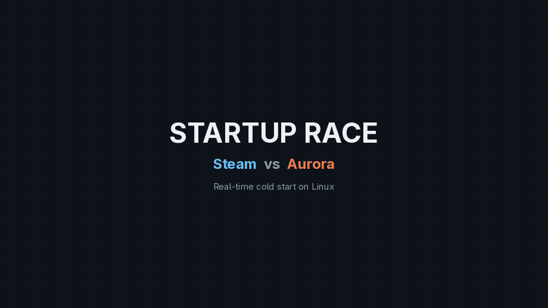
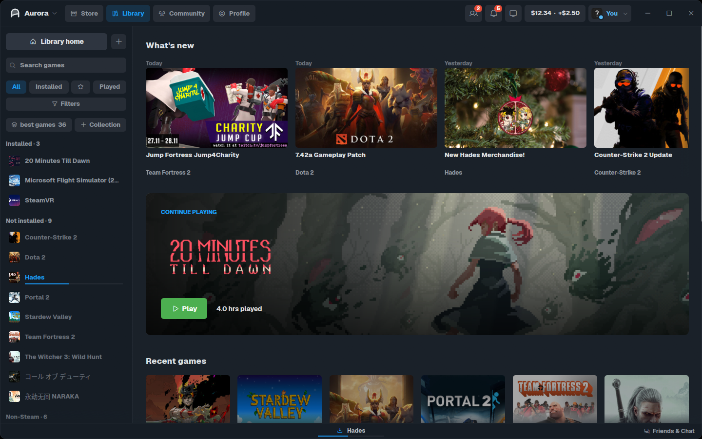
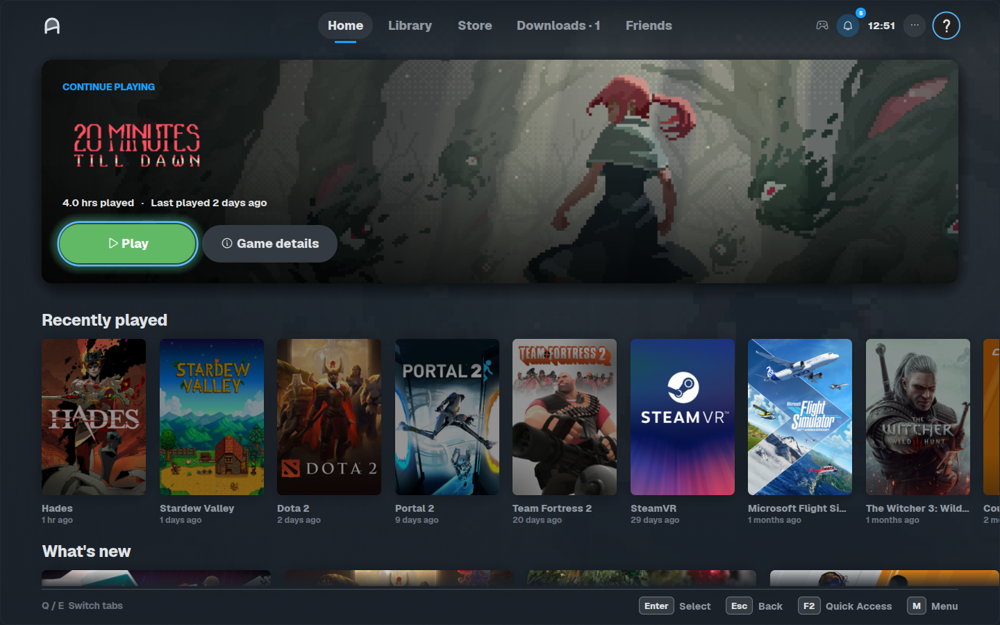
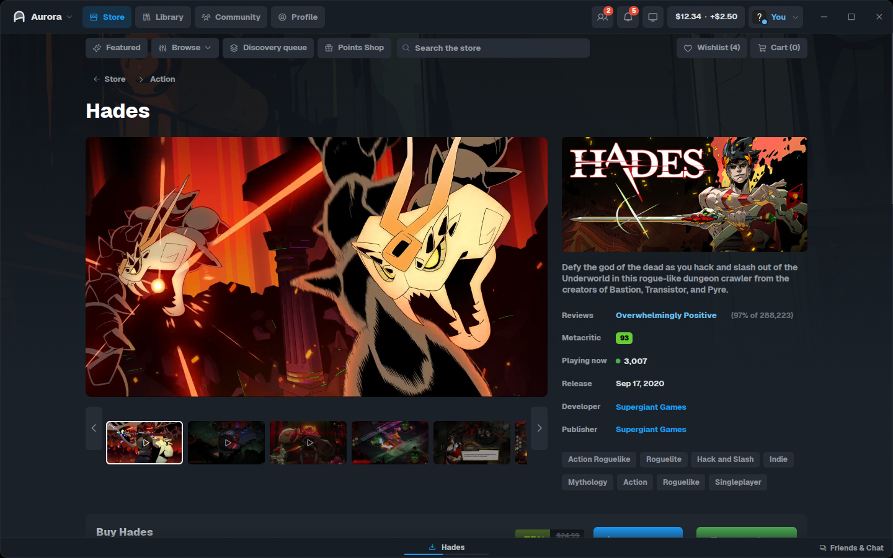
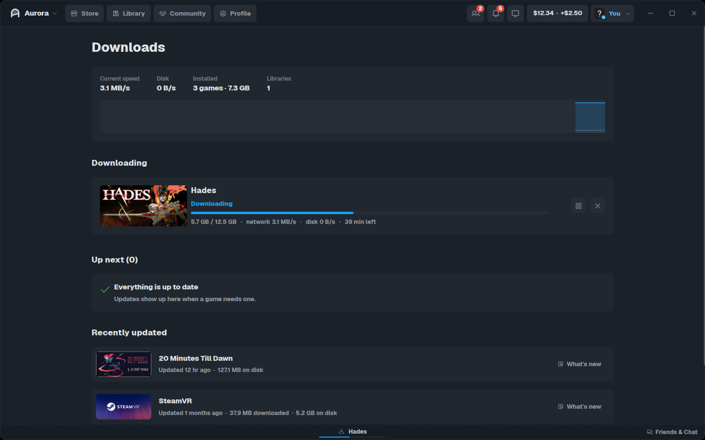

<p align="center">
  
</p>

<p align="center">
  <a href="https://auroraclient.eu/"><b>Website</b></a> ·
  <a href="#screenshots"><b>Screenshots</b></a> ·
  <a href="#faq"><b>FAQ</b></a> ·
  <a href="#benchmarks"><b>Benchmarks</b></a> ·
  <a href="#download"><b>Download</b></a> ·
  <a href="#status"><b>Status</b></a> ·
  <a href="CHANGELOG.md"><b>Changelog</b></a>
</p>

<p align="center">
  <a href="https://github.com/mollie2999/Aurora/releases/latest"></a>
  
  
</p>

<p align="center">
  
</p>

# Aurora

**A fast, lightweight native Steam client for Linux and Windows, written in Rust.**

No embedded Chromium, no fleet of `steamwebhelper` processes. Aurora draws your
Store, Library, Downloads, Friends & Chat, Workshop, Steam Families, Inventory,
Steam Cloud, Shift+Tab overlay, and Big Picture / Steam Deck UI natively on the
GPU with [egui](https://github.com/emilk/egui) in **one process**—idling at
**~150 MB of RAM** instead of **1.6 GB** and opening its first window in
**0.18 s**.

- **Built for Linux & Windows:** native Wayland and X11 on Linux, per-game
  Proton selection, Vulkan Shift+Tab overlay, windowless Steam host, system tray
  and desktop notifications, plus native packages for Arch, Debian/Ubuntu,
  Fedora, AppImage (SteamOS/Bazzite), and Windows.
- **Big Picture & Steam Deck UI:** controller-first fullscreen interface with
  Quick Access menu (`aurora --bigpicture` or `aurora --steam-deck`).
- **Custom themes & Rhai plugins:** declarative theme support (with Native
  Adwaita and Aurora Desktop themes bundled out of the box) and sandboxed Rhai plugins.
- **Try without signing in:** run `aurora --demo` to explore the interface with
  sample data before ever entering your Steam account.

Originally built on [SteamInRust](https://github.com/madonchik123/SteamInRust)
by madonchik123, Aurora expands it into a cross-platform Linux and Windows
client. Free, open source (MIT), and unofficial.

## Screenshots

<table>
  <tr>
    <td width="50%">
      
      <p align="center"><sub><b>Desktop Library</b> — fast native UI, collections, filters, and What's new</sub></p>
    </td>
    <td width="50%">
      
      <p align="center"><sub><b>Big Picture &amp; Deck Mode</b> — fullscreen controller &amp; keyboard navigation</sub></p>
    </td>
  </tr>
  <tr>
    <td width="50%">
      
      <p align="center"><sub><b>Native Store</b> — trailers, Discovery Queue, Points Shop, tags, and reviews</sub></p>
    </td>
    <td width="50%">
      
      <p align="center"><sub><b>Downloads</b> — resumable depot downloader with separate network &amp; disk speeds</sub></p>
    </td>
  </tr>
</table>

<sub>Captured on Aurora <code>1.0.0-rc4</code> using <code>aurora --demo</code> (sample account data, no sign-in required).</sub>

## FAQ

### Is Aurora safe to use with my Steam account?
Yes. Aurora signs in directly to Valve using the same Steam authentication
protocol as the official desktop client and the Steam Mobile app (password,
Steam Guard, or QR code). Your credentials stay on your own PC in private
user storage and are never sent anywhere except Steam. The entire codebase is
MIT-licensed with **zero telemetry**—outside of Steam, Aurora only contacts
GitHub for updates, an exchange-rate service when checking gift regions, and
optionally IsThereAnyDeal if you supply your own API key. You can also test
everything safely first with `aurora --demo` without signing in.

### Will Aurora get me banned in VAC, Easy Anti-Cheat, or BattlEye games?
Aurora does not modify games or inject into anti-cheat. By default on Linux,
Aurora launches games through the windowless Steam host using Valve's own
installed Steam engine; the first time you try an anti-cheat title on the
headless host, Aurora shows an explicit warning about potential launch
failures, kicks, or bans. Valve's official Steam client remains available
whenever you prefer to run anti-cheat titles through the standard Steam UI.

### Why do I still need Steam installed on Linux?
Aurora reuses your existing Steam installation on disk for **Proton**, shader
caches, and Valve's Steamworks/DRM engine via the windowless Steam host. You do
not need to launch or leave Valve's Chromium desktop interface running in the
background (which saves ~1.5 GB of RAM and ~27 processes).

### How is Aurora different from SteamInRust?
Aurora started from [SteamInRust](https://github.com/madonchik123/SteamInRust)
by madonchik123 and grew into a Linux-and-Windows Steam client. On top of the
Rust/egui foundation, Aurora adds full Linux support (Wayland and X11),
per-game Proton launching, the windowless Steam host for native and SteamStub
DRM games, a Linux Vulkan Shift+Tab overlay, Big Picture & Steam Deck Game Mode,
Steam Families, Steam Input controller settings, live Steam Broadcast viewing,
a declarative theme engine, 4 UI languages, security hardening, and native
Linux/Windows packaging.

### Does Aurora bypass Steam DRM or let you play unowned games?
No. Ownership and DRM handling are strictly fail-closed: SteamStub DRM and
native games authenticate through Valve's own engine on your signed-in Steam
account.

## Every game launches

Aurora starts installed Steam games through the windowless Steam host by
default when Aurora is online and the host is available. The host uses your
installed Steam engine for Steamworks and ownership checks.

On Linux, games with both builds installed use the native build by default.
**Manage › Compatibility** switches a game to Proton or to a specific Proton
version. On Windows, games run natively.

The first time you try an anti-cheat game on the headless host, Aurora asks
you to acknowledge the risk of launch failures, kicks or bans. The official
Steam client is still available for games that need it. Compatible games can
also start when the host is unavailable.

## Benchmarks

**Aurora 1.0.0-rc4** against the official Steam client (build `1792618285`,
vanilla with mods unhooked), on the same PC and Steam account: AMD Ryzen 7
5700X, 16 GB RAM, NVIDIA GeForce RTX 5070, CachyOS with GNOME on Wayland.
Measured on **25 November 2026**. Every figure is the median of 3 runs after a
warm-up run:

| Metric | Steam | Aurora 1.0.0-rc4 | Difference |
| --- | ---: | ---: | ---: |
| Start → first window | 3.41 s | **0.18 s** | **19× faster** |
| Start → main window, signed in | 5.55 s | **2.18 s** | **2.5× faster** |
| Memory when idle (PSS, all processes) | 1,637 MB | **150 MB** | **10.9× less RAM** |
| CPU when idle | 14.1 % of a core (12.2–16.9 %) | **0.3 %** | **43× less CPU** |
| Running processes | 28 | **1** | **Single process** |
| Program size (excluding games/caches) | 2,217 MB | **63 MB** | **35× smaller** |

Both clients signed in automatically on launch. Idle memory is measured 45 s
after the main window opens; idle CPU is measured over the following 30 s.
Steam's program size excludes games, user data, caches, compatibility tools,
and mods. Aurora's size includes `aurora`, `steamhost`, the Linux Vulkan
overlay layer, and both Windows `steamclient` DLLs. Aurora still needs Steam
installed on disk on Linux for Proton and the Steam host.

Full methodology, script, and every individual run:
[docs/benchmarks-linux.md](docs/benchmarks-linux.md).

## Download

Get the latest build from
[GitHub Releases](https://github.com/mollie2999/Aurora/releases/latest):

| File | Platform & install |
| --- | --- |
| `Aurora-<version>-x86_64.AppImage` | **Linux x86_64 (AppImage)** — portable for SteamOS, Bazzite, and immutable distros; supports [Gear Lever](https://mijorus.it/projects/gearlever/) & `.zsync` updates |
| `aurora-bin-<version>-1-x86_64.pkg.tar.zst` | **Arch Linux / CachyOS / EndeavourOS** — `sudo pacman -U ./aurora-bin-….pkg.tar.zst` (`PKGBUILD` also attached) |
| `aurora_<version>_amd64.deb` | **Debian, Ubuntu 22.04+, Linux Mint, Pop!_OS** — `sudo apt install ./aurora_…_amd64.deb` |
| `aurora-<version>-1.x86_64.rpm` | **Fedora, openSUSE, RHEL-based** — `sudo dnf install ./aurora-….rpm` |
| `Aurora-Linux-x86_64.tar.gz` | **Generic Linux x86_64** — unpack and run `./aurora` |
| `Aurora-<version>-x86_64.flatpak` | **Experimental Flatpak** — `flatpak install --user ./Aurora-….flatpak` (Flathub submission planned once ready) |
| `Aurora-Setup-<version>.exe` | **Windows 10 / 11 (64-bit)** — user-level installer with automatic updates |
| `Aurora-<version>-portable.zip` | **Windows 10 / 11 (64-bit)** — portable archive, no installer |

> **Note on Flatpak:** The experimental Flatpak keeps its own settings and
> library data. It bundles the `steamhost` helper, which needs access to Valve's
> Steam engine for the headless launch path. Use a native package or AppImage
> for the smoothest host Steam, Proton, and in-game overlay integration.

Store trailers on Linux need `ffmpeg`, and `libpulse` for sound.

## Status

Aurora's feature coverage compared with Valve's Steam desktop client on
Windows and Linux.

**0** unavailable · **0.25** limited support · **0.5** usable with major gaps ·
**0.75** most common workflows covered · **1** covers the workflows Aurora
targets for that feature. The table notes intentional exclusions, browser
handoffs, and Steam dependencies. Compatibility can vary by game, platform,
and package.

| Steam desktop feature | Aurora / 1 | Coverage and limits |
| --- | ---: | --- |
| Sign-in and accounts | 1 | Password, Steam Guard, QR sign-in, and saved accounts. Sensitive account changes open Steam's website. |
| Steam Families | 0.75 | Shared library, family creation, invites, and member management. Parental controls and purchase requests open Steam's website. |
| Offline mode and reconnecting | 0.75 | Cached library, offline launches for supported games, and automatic reconnect. Steam's handling of reported offline playtime is unconfirmed. |
| Library and collections | 0.75 | Search, filters, non-Steam shortcuts, synced static collections, and optional hiding of the What's new shelf. Steam's dynamic collections are read-only. |
| Downloads, installs, and storage | 1 | Queued and resumable downloads, drag reordering, scheduled updates, file verification, library moves, and backup and restore. Local network game transfers are outside Aurora's scope. |
| Store and purchases | 1 | Search, trailers, wishlist, Discovery Queue, Points Shop, and review writing. Payment is handled on Steam's website. |
| Friends and chat | 0.75 | Friends list, presence, invites, direct messages, and group text chats. Voice channels are visible in group chat, with no support for voice calls. |
| Community | 0.75 | Activity feed, profile editing, game hubs, guides, and discussion browsing. Some community actions still open Steam's website. |
| Workshop | 0.75 | Browse, subscribe, and download mods. Publishing support covers single-file uploads through the in-game API. |
| Inventory, trading, and Market | 0.5 | View inventory, check prices, list items, and send basic trade offers. The trade inbox and Market browsing open Steam's website. |
| Steam Cloud | 1 | Per-game sync, conflict resolution with local backups, and viewing and deleting remote saves. |
| Game launch and Proton | 1 | Native Linux launches and per-game Proton selection. The windowless Steam host is the default when available. Anti-cheat games show a first-launch warning. |
| In-game Steam features | 0.75 | Achievements, stats, lobbies, and other Steamworks features on supported routes. Aurora's own implementation lacks Steam Datagram Relay for modern multiplayer. |
| Steam Input | 0.5 | Controller testing, calibration, per-game overrides, community layouts, and binding editing. In-game support depends on the game and launch route. |
| Shift+Tab overlay | 1 | In-game rendering on supported Windows games and via a Vulkan layer on Linux, with a window fallback on some launch paths. Includes notes, screenshots, and an FPS counter. An in-game browser is outside Aurora's scope. |
| Desktop integration | 0.75 | Desktop notifications and tray menus on Windows and supported Linux desktops. Registering Aurora as the `steam://` link handler is Windows-only. |
| Settings, languages, and updates | 0.75 | English, French, Spanish, and Russian UI. Windows installer updates automatically; Linux AppImage supports Gear Lever / `.zsync` updates. |
| Steam Broadcast | 0.25 | Aurora can watch live broadcasts on Linux. Hosting broadcasts is unavailable. |
| Big Picture | 0.75 | Fullscreen Library, Store, Downloads, Friends, text chat, and settings with controller and keyboard navigation. |
| Remote Play | 0 | No game streaming or Remote Play Together. |
| Game Recording | 0 | No gameplay clip recording. |

Open Big Picture with the monitor button, the app menu, the controller's
Guide button while Aurora is focused, or `aurora --bigpicture`. Use
`--bigpicture=window` to open it in a window.

To try Aurora's Deck interface on a desktop, use `aurora --steam-deck`
(full screen) or `aurora --steam-deck=window`. Press `F2` or click
**Quick Access** while Big Picture has focus. Press `Esc` to go back, `F1` for
the main menu, and `F11` to toggle fullscreen. The preview uses your normal
Aurora library and settings; it does not emulate Deck hardware, claim a SteamOS
session, or activate system-level controls.

See [Steamworks compatibility](docs/steam-compatibility.md) for in-game API
details and the [changelog](CHANGELOG.md) for release history.

## Build from source

Needs [Rust](https://rustup.rs). On Linux, install the libudev development package (`libudev-dev` on Debian and Ubuntu).

```sh
git clone https://github.com/mollie2999/Aurora.git
cd Aurora
cargo build --release -p aurora -p steamhost
target/release/aurora            # sign in with your account
target/release/aurora --demo     # sample data, no sign-in
```

The Windows `steamclient` DLLs that Proton games load are built by CI
(`.github/workflows/build.yml`); copy them next to `aurora` from a release.

## Credits

Built on [SteamInRust](https://github.com/madonchik123/SteamInRust) by
madonchik123. Fonts: [Geist](https://github.com/vercel/geist-font) and
[Inter](https://rsms.me/inter/) (OFL). Icons: [Phosphor](https://phosphoricons.com) (MIT).
Protocol definitions: [SteamDatabase/Protobufs](https://github.com/SteamDatabase/Protobufs).
Price history: [IsThereAnyDeal](https://isthereanydeal.com).

## License

[MIT](LICENSE). Unofficial. Not affiliated with Valve. Steam is a trademark of
Valve Corporation.
